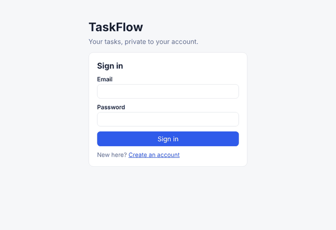
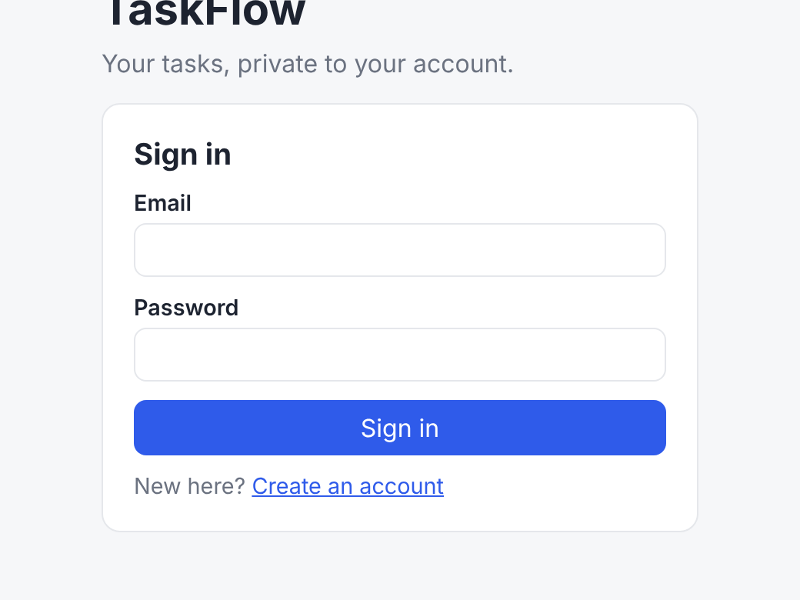
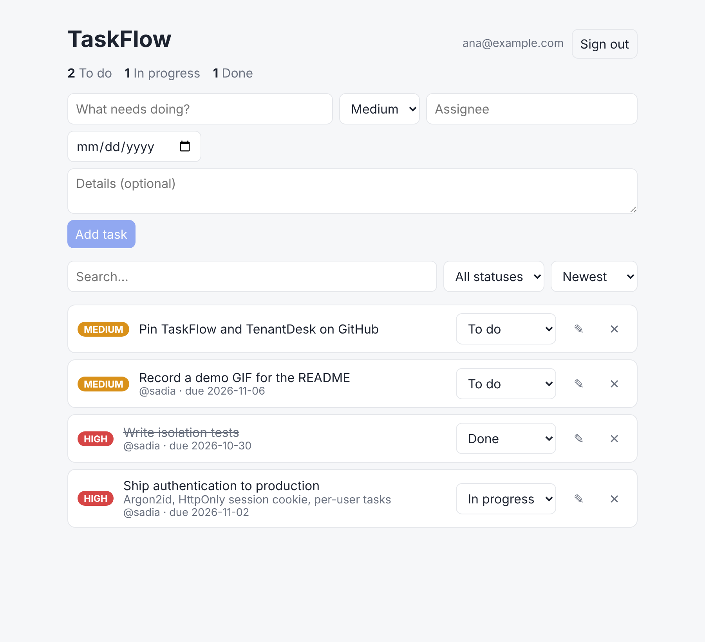
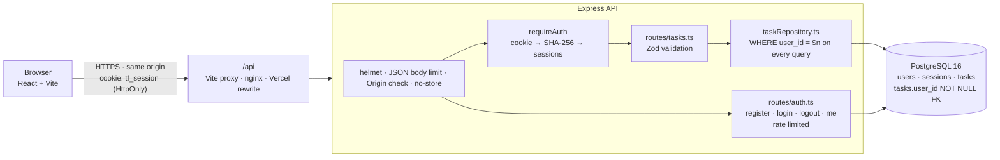

# TaskFlow

[](https://github.com/aliou21toure-jpg/taskflow/actions/workflows/ci.yml)
[](https://taskflow-demo-tau.vercel.app)

A full-stack task manager with user accounts: a **TypeScript + Express REST API** on
**PostgreSQL** and a **React** frontend. Every user signs in and sees only their own tasks.
The API enforces this in every SQL query, and 86 automated tests check it.

**[Try the live demo →](https://taskflow-demo-tau.vercel.app)** Create your own account, or
click *Try the demo account* on the sign-in screen.



## Features

**Accounts and security**
- Registration, sign-in and sign-out. Passwords are hashed with **Argon2id** using OWASP's
  recommended parameters.
- Sessions use a random 256-bit token in an `HttpOnly`, `Secure`, `SameSite=Lax` cookie.
  Page scripts can't read it, and the database stores only its SHA-256 hash.
- Every login issues a new token, so a pre-set token can't be reused (no session fixation).
  Signing out deletes the session on the server, so a copied cookie stops working.
- A wrong password and an unknown email get the same response in the same time. Attackers
  can't use sign-in to find out which emails have accounts.
- Sign-in and registration are rate-limited. Writes coming from another website are refused
  (an `Origin` check on top of SameSite).
- **Per-user isolation.** Every query filters on `user_id`. Another user's task returns 404,
  exactly like a task that doesn't exist. The database refuses a task with no owner.

**Tasks**
- Create, edit (title, description, priority, assignee, due date), change status and delete
- Filter, search, sort and paginate. All SQL is parameterized, and `LIKE` wildcards are escaped.
- Strict Zod schemas reject unknown fields, so you can't set `user_id` or `id` in a request body.

**Frontend**
- Sign-in and sign-up screens. When the session ends, the app returns to sign-in and says why.
- Loading indicators, per-task busy states, and error messages you can retry
- A failed save keeps what you typed in the form, and search waits until you stop typing

| Sign in | Your tasks |
|---|---|
|  |  |

## Architecture



The React app and the API always share one origin: a Vite proxy in development, nginx in
Docker, and a rewrite on Vercel. The session cookie is therefore first-party, and no CORS
setup is needed.

| Layer | File | Responsibility |
|---|---|---|
| Config | `api/src/config.ts` | Validate environment variables, fail fast |
| HTTP | `api/src/app.ts` | Middleware, health check, wiring, error handling |
| Auth | `api/src/routes/auth.ts`, `middleware/auth.ts` | Accounts, sessions, `requireAuth` |
| CSRF | `api/src/middleware/sameOrigin.ts` | Refuse cross-site writes |
| Routes | `api/src/routes/tasks.ts` | Parse input → call repository → shape response |
| Data | `api/src/lib/*Repository.ts` | All SQL, always scoped to the signed-in user |
| Schema | `api/sql/*.sql` | Tables, constraints, indexes, `updated_at` trigger |

## API

| Method | Endpoint | Auth | Description |
|---|---|---|---|
| `GET` | `/health` | – | Database connectivity check |
| `POST` | `/auth/register` | – | Create an account and sign in (`201`, `409` if the email is taken) |
| `POST` | `/auth/login` | – | Sign in (`401` with a generic message on failure) |
| `POST` | `/auth/logout` | – | End the session on the server |
| `GET` | `/auth/me` | ✓ | The signed-in user |
| `POST` | `/tasks` | ✓ | Create a task |
| `GET` | `/tasks` | ✓ | List your tasks: `?status=&priority=&assignee=&q=&sort=&order=&limit=&offset=` |
| `GET` | `/tasks/stats` | ✓ | Count of your tasks per status |
| `GET` | `/tasks/:id` | ✓ | Get one of your tasks |
| `PATCH` | `/tasks/:id` | ✓ | Update some fields |
| `DELETE` | `/tasks/:id` | ✓ | Delete a task |

Errors always look like `{ "error": { "message": "...", "details": [...] } }`.

## Run it

**With Docker (everything):**
```bash
docker compose up --build
# open http://localhost:5173  (nginx serves the UI and proxies /api to the API)
```

**Locally (for development):**
```bash
docker compose up -d db          # PostgreSQL only
cd api
cp .env.example .env && cp .env.test.example .env.test
npm install
npm run db:migrate && npm run db:migrate:test
npm run dev                      # API on :3000

cd ../web
npm install
npm run dev                      # UI on :5173, proxies /api to :3000
```

**Deploy:** see [`deploy/vercel/README.md`](deploy/vercel/README.md). The live demo runs the
API as a serverless function and the UI as static files on one HTTPS origin, with PostgreSQL
on Supabase.

## Tests

```bash
cd api && npm test        # 68 integration tests against a real PostgreSQL test database
cd web && npm test        # 18 React tests against an in-memory fake API
```

| Area | What is checked |
|---|---|
| Authentication | Register, login, logout, duplicate email, weak or invalid input, Argon2id hash format, hashed session tokens, cookie flags, new token per login, expired and forged sessions, rate limiting |
| Authorization | `401` on every task endpoint without a session. Another user can't read, list, search, update or delete your tasks, or create one in your name. Database-level owner constraint and cascade |
| CSRF | A write from another origin is refused; one from the app's own origin is allowed |
| Tasks | CRUD, validation, unknown-field rejection, filters, search with literal wildcards, sorting, pagination |
| Frontend | Sign-in and sign-up flows and errors, sign-out, session expiry, unreachable server, failed create, edit and delete (the form keeps your input), editing every field, debounced search |

The API tests refuse to run unless `DATABASE_URL` points at a database whose name ends in
`_test`, because they truncate tables. CI runs both suites, the type checks, the builds and
the Docker builds on every push and pull request.

## Security notes and limits

- The rate limiter keeps its counts in memory, so each server instance counts separately. A
  multi-instance deployment would use a shared store such as Redis.
- Registration returns `409` for an email that is already taken, so it does reveal that the
  account exists. This is a deliberate usability trade-off (sign-in does not reveal it); a
  stricter design would confirm by email instead.
- The public demo account is shared by every visitor, so anyone can change its tasks. Create
  your own account to see the isolation for yourself.

## Tech stack

TypeScript · Node.js · Express 5 · PostgreSQL 16 · node-postgres · Zod · Argon2 · Vitest ·
Supertest · React 19 · Vite · Testing Library · Docker · nginx · GitHub Actions · Vercel
